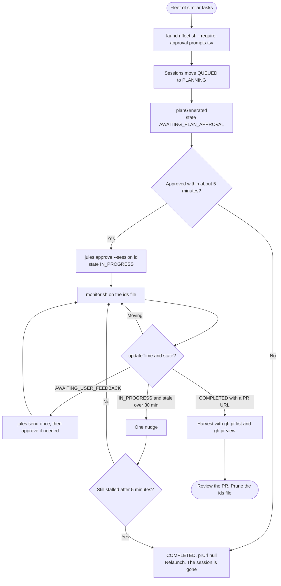

# jules

Google Jules async-coding-agent fleet operations.

This skill teaches you how to launch many Jules sessions in parallel,
get through their plan-approval step without dropping them on the floor,
detect stuck vs. dead sessions, and harvest the resulting PRs — without
burning your 15-concurrent / 100-per-day quota on silently-terminated
sessions.

## What you'll learn

1. **The `requirePlanApproval` transport bug** — and why every fresh
   launch hangs at `AWAITING_PLAN_APPROVAL` until you either pass
   `--require-approval` explicitly or push the auto-approve through
   `jules/src/transport.ts`. (The transport fix lives in the
   `~/Projects/giacos-zsh-toolkit/jules` package; this skill is the
   operational complement.)
2. **Approval workflow** — the exact `jules approve --session <id>`
   sequencing that keeps a 6-session fleet alive.
3. **Liveness vs stall** — when `state: IN_PROGRESS` is doing real work
   vs when it's silently dead and burning your quota.
4. **Nudging** — when and how `jules send` actually moves the needle
   (and when it's a no-op that just wastes effort).
5. **Quota math** — the 15-concurrent / 100-per-day numbers and what
   happens when you cross them.

## Install

The fastest cross-agent install path is the `skills` CLI:

```bash
npx skills add gg-skills/jules
```

Drop this skill into a workspace as a Git submodule for pinned
versions, or as a plain clone for latest `main`:

```bash
# Project-local, version-pinned:
git submodule add git@github.com:gg-skills/jules.git .claude/skills/jules

# OR project-local, latest main:
mkdir -p .claude/skills
git -C .claude/skills clone git@github.com:gg-skills/jules.git

# OR user-level, available in every project on this machine:
mkdir -p ~/.claude/skills
git -C ~/.claude/skills clone git@github.com:gg-skills/jules.git
```

Restart your agent or reload skills after installation. See the parent
[`skills` catalog repo](https://github.com/gg-skills/skills) for the
full catalog.

## When to use

Trigger on any of these (see `SKILL.md` for the full matrix):

- You want to batch-convert N bash/python scripts, fix N similar bugs,
  or run any "do the same thing N times in N branches" workflow through
  Jules async sessions.
- A Jules session is parked at `AWAITING_PLAN_APPROVAL` and you must
  decide approve / reject / clarify.
- The user asks "is it done?" / "did they finish?" / "is anything
  stuck?" for a fleet — you need a poller that summarizes state per
  session without spamming the API.
- A session shows `IN_PROGRESS` but no new `progressUpdated`
  activities for 15+ minutes, and you must decide nudge / wait / abort.

Skip this skill for:

- A single interactive Jules session — handle directly.
- Questions about the `jules` CLI surface itself — open
  `~/Projects/giacos-zsh-toolkit/jules/src/cli.ts`.
- Other async-coding agents (Devin, Codex background, Factory, Aider).

## How it operates

### Inputs

**A fleet definition** — a TSV of `tool<TAB>prompt-file` rows, plus the target repo and branch.

**Session ids** — `.jules-fleet-ids` (or `JULES_IDS_FILE`) after launch. Each row is `tool`, session id, and URL.

**Live session state** — `jules` CLI or the Jules API. Trust `updateTime` for liveness. Activity counts lag during long installs and compiles.

### Outputs

- A session-id file from `launch-fleet.sh`.
- One monitor line per session: state, activity count, age of the last activity, PR URL, and an `APPROVE ME` or `STALLED` flag.
- Approved plans, at most one nudge per stuck interval, and harvested PR URLs.
- A relaunch when a session reaches `COMPLETED` with no PR, or stays stalled after one nudge.

### External commands

```bash
.agents/skills/jules/scripts/launch-fleet.sh --require-approval prompts.tsv
.agents/skills/jules/scripts/monitor.sh .jules-fleet-ids
.agents/skills/jules/scripts/nudge.sh <sid>
jules approve --session <sid>
jules send --session <sid> --prompt "Continue."
```

Quota is 15 concurrent sessions and 100 creates per rolling 24 hours. A 16th concurrent create, or a 101st create in the window, returns 429.

### Side effects

- Creates Jules sessions and, after approval, the PRs those sessions open.
- Writes the local ids file. Prune completed or abandoned rows so later polls do not treat a final state as live work.
- Does not edit the `jules` CLI. The `requireApproval` transport fix lives in the toolkit package this skill complements.
- An unapproved plan dies on the server in about 7 minutes as `COMPLETED` with no PR. That session cannot be recovered.

### Mode toggles

| Mode | Behavior |
|------|----------|
| `--require-approval` | Launch, then approve within about 5 minutes of `planGenerated` |
| `--auto-approve` | Skip the approval gate. Use only when the prompts are already trusted |
| `AWAITING_PLAN_APPROVAL` | `jules approve`. Doing nothing ends the session with no PR |
| `AWAITING_USER_FEEDBACK` | `jules send` once, then approve if a new plan appears |
| `IN_PROGRESS` and `updateTime` moving | Leave it alone. `jules send` is a no-op while the agent loop is running |
| Stale more than 30 minutes | One nudge, then relaunch. Do not loop `send` |

## Operational flow



## Layout

```
skills/jules/
├── SKILL.md                              ← trigger conditions + overview + decision tree
├── README.md                             ← you are here
├── references/
│   ├── approval-workflow.md              ← the requirePlanApproval bug + recovery
│   ├── monitoring.md                     ← monitor.sh in detail + liveness heuristic
│   ├── launch-and-handle.md              ← end-to-end fleet lifecycle, copy-pasteable
│   └── state-machine.md                  ← full state graph with quota implications
└── scripts/
    ├── monitor.sh                        ← per-session state + last-age + PR + flag
    ├── nudge.sh                          ← send a follow-up with rotating templates
    └── launch-fleet.sh                   ← bulk-launch from a TSV of prompts
```

## Quick start

After the install above, drop a TSV of `<tool>\t<prompt-file>` rows
into e.g. `prompts.tsv`, then:

```bash
# 1. launch
.agents/skills/jules/scripts/launch-fleet.sh --require-approval prompts.tsv

# 2. poll until plans are ready
.agents/skills/jules/scripts/monitor.sh .jules-fleet-ids
# → see "← APPROVE ME" rows

# 3. batch-approve
while read -r tool sid url; do jules approve --session "$sid"; done < .jules-fleet-ids

# 4. monitor long-running execution
watch -n 60 .agents/skills/jules/scripts/monitor.sh .jules-fleet-ids
# → see "← STALLED" rows when sessions are quiet for >30 min

# 5. nudge stalled sessions (one shot per stuck interval)
.agents/skills/jules/scripts/nudge.sh <sid>

# 6. harvest PRs
gh pr list --repo OWNER/REPO --state open --json number,title | jq
```

## Companion skills

- `ts-symbol-clarity` — for the naming review of the new TypeScript
  packages after PRs land.
- `eslint-inventory` — for the shared eslint config at
  `tooling/eslint.config.ts` that new packages should reference.
- `cognitive-complexity` — for the SonarJS `cognitive-complexity`
  threshold (30) the conventions enforce.
- `ts-file-overviews` — for the `@fileoverview` + `@see` JSDoc
  convention this skill's transport fix expects.

## Companion code

- `~/Projects/giacos-zsh-toolkit/jules/src/transport.ts` — the
  `requireApproval` fix that this skill relies on.
- `~/Projects/giacos-zsh-toolkit/bin/launch-ts-conversions.sh` —
  the concrete example of a fleet launcher; pattern-match this when
  you build your own.
- `~/Projects/giacos-zsh-toolkit/bin/ts-conversion-prompts/*.txt` —
  the six template prompts that the launch script reads, useful as
  starting points for your own batches.

## Cross-references

- `~/Projects/gg-skills/skills/git-submodules/SKILL.md` — for
  managing this skill repo as a submodule of your own monorepo.

## Resources

- [`SKILL.md`](./SKILL.md) — quota, the approval gate, liveness, nudges, and PR harvest
- [`references/approval-workflow.md`](references/approval-workflow.md) — why `requirePlanApproval` silently ends a session
- [`references/state-machine.md`](references/state-machine.md) — states and what each transition costs
- [`references/monitoring.md`](references/monitoring.md) — `monitor.sh` and `updateTime`
- [`references/launch-and-handle.md`](references/launch-and-handle.md) — launch through review, with shell to copy

## Caveats

- **Approve or lose the session.** `AWAITING_PLAN_APPROVAL` becomes `COMPLETED` with no PR after about 7 minutes, and that session cannot be resumed.
- **Pass `requireApproval` explicitly.** The SDK otherwise forces the approval gate and the session waits until it dies.
- **Stay inside 15 concurrent and 100 creates per day.** The next create returns 429.
- **`IN_PROGRESS` with a quiet activity list is not dead** while `updateTime` is still moving. Long installs look like this.
- **Nudge once.** Repeating `jules send` queues messages the agent loop will not drain, and `send` does nothing useful during active `IN_PROGRESS`.
- **`COMPLETED` without `prUrl` is a failed gate.** Relaunch. Do not keep polling it.
- **Prune the ids file** after merge or after you abandon a session, or later status checks report finished work as if it were current.
